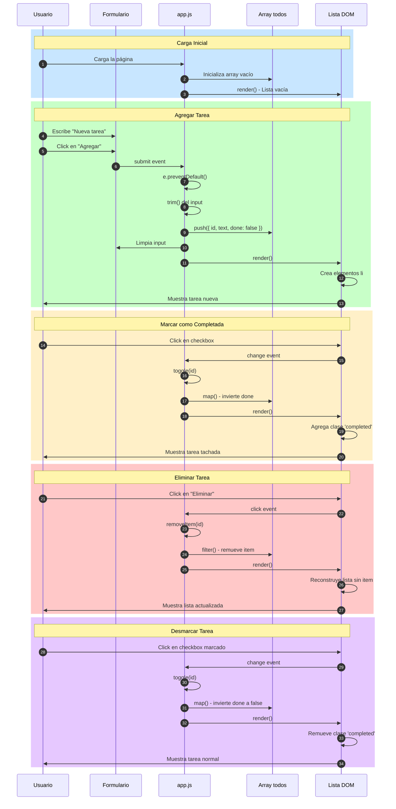

# Diagrama de Secuencia - Todo App

## Descripción de las Etapas

- **Azul claro**: Carga inicial de la aplicación
- **Verde**: Proceso de agregar una nueva tarea
- **Amarillo**: Marcar una tarea como completada
- **Rojo claro**: Eliminar una tarea
- **Morado claro**: Desmarcar una tarea completada

## Componentes Clave

- **Usuario**: Interactúa con la interfaz
- **Formulario**: Captura nuevas tareas
- **app.js**: Lógica de la aplicación
- **Array todos**: Almacenamiento en memoria
- **Lista DOM**: Renderizado visual de las tareas
